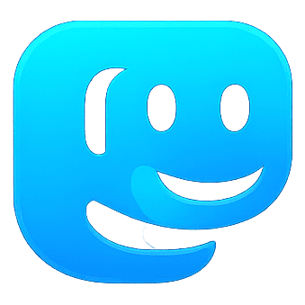

#  Minimalist Mastodon Share Widget (PHP)

          

[DEUTSCH]
Ein extrem leichtgewichtiges, sicheres und schickes Tool zum Teilen von Inhalten auf Mastodon. 
Speziell für ressourcenschonendes Hosting (Docker/Portainer) entwickelt.

**Features:**
- 💎 **Glassmorphism Design:** Moderner Apple-Style Look.
- 🛡️ **Sicherheit:** Instanz-Verifizierung, auswählbares Mathe-/Turnstile-/Cap-Captcha & HoneyPot.
- 🌍 **Spracherkennung:** Erkennt automatisch DE oder EN.
- 🧠 **Gedächtnis:** Merkt sich die letzte Instanz (abschaltbar).
- 🛠️ **Generator:** Erzeuge einfach Links für deine eigenen Webseiten.

**Installation:**
1. Kopiere das Repository auf deinen Server.
2. Kopiere `.env.example` nach `.env` und passe die Werte an.
3. Starte den Stack: `docker-compose up -d`.

**Konfiguration:**
- `CAPTCHA_TYPE`: `math` (Standard), `turnstile` oder `cap`.
- Für `turnstile`: `TURNSTILE_SITE_KEY` und `TURNSTILE_SECRET_KEY` setzen.
- Für `cap`: `CAP_URL` (Basis-URL des Cap-Servers), `CAP_SITE_KEY` und `CAP_SECRET_KEY` setzen.
- `HEADER_CODE` fügt optional HTML-Code direkt in den `<head>` ein. Nur vertrauenswürdigen Code eintragen.

---

[ENGLISH]
An extremely lightweight, secure, and stylish tool for sharing content on Mastodon.
Designed specifically for resource-efficient hosting.

**Features:**
- 💎 **Glassmorphism Design:** Modern Apple-style aesthetics.
- 🛡️ **Security:** Instance verification, selectable Math/Turnstile/Cap CAPTCHA & HoneyPot.
- 🌍 **Language Detection:** Automatically detects DE or EN.
- 🧠 **Memory:** Remembers the last used instance (optional).
- 🛠️ **Generator:** Easily create share links for your own websites.

**Installation:**
1. Clone the repository.
2. Copy `.env.example` to `.env` and configure the values.
3. Run the stack: `docker-compose up -d`.

**Configuration:**
- `CAPTCHA_TYPE`: `math` (default), `turnstile`, or `cap`.
- For `turnstile`, set `TURNSTILE_SITE_KEY` and `TURNSTILE_SECRET_KEY`.
- For `cap`, set `CAP_URL` (the Cap server base URL), `CAP_SITE_KEY`, and `CAP_SECRET_KEY`.
- `HEADER_CODE` optionally inserts HTML directly into `<head>`. Only enter trusted code.